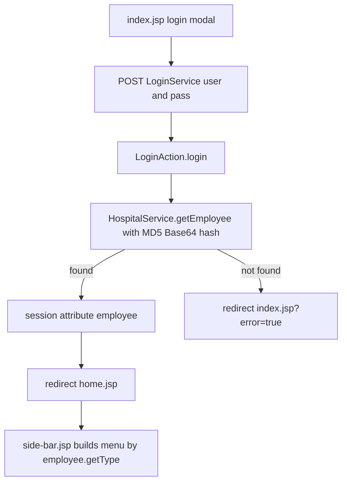
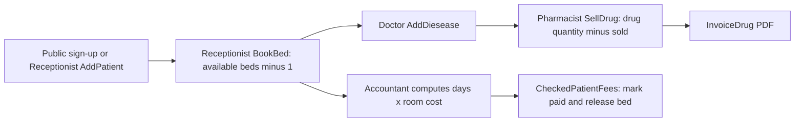
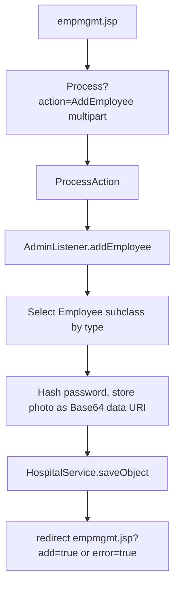
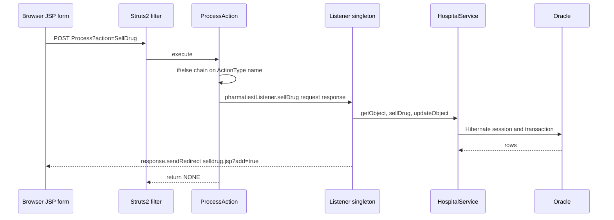

# Hospital Management System - Architecture and Functional Analysis

## 1. Executive Summary

HospitalSystemV2 is a role-based hospital administration web application packaged as a WAR (`target/HospitalSystemV2-1.0-SNAPSHOT.war`) for Tomcat 9. It lets hospital staff manage employees, patients, rooms and beds, diagnoses, pharmacy stock and sales, patient billing, nurse shifts and internal messaging, and produces PDF reports and invoices.

| Aspect | Technology |
|---|---|
| Web framework | Struts 6.8.0 (`StrutsPrepareAndExecuteFilter` mapped to `/*`) |
| View | JSP + JSTL 1.2 + scriptlets, Bootstrap / Material Dashboard / jQuery / DataTables |
| Persistence | Hibernate 5.6.15 (annotations, `hbm2ddl.auto=update`) on Oracle (`ojdbc8`) |
| Reporting | JasperReports 7.0.7 + `jasperreports-pdf` (OpenPDF) |
| Runtime | Java 17, `javax.*` namespace, Tomcat 9 |

Key characteristics:

- Business logic is **not** in Struts actions or form beans. Struts is used as a front controller; the work is done by `*Listener` singletons that read `HttpServletRequest` parameters directly and call a single `HospitalService` DAO facade.
- There are **no Struts ActionForms / model-driven beans, no Struts validation framework (`validation.xml`) and no interceptors configured beyond `struts-default`**. Validation is client-side HTML5 plus ad-hoc server code.
- JSPs query the DAO layer directly via scriptlets (`HospitalService.getInstance()`), so the view and data access layers are coupled.

## 2. Functional Overview

### 2.1 Business domain

Hospital operations for a single facility: staff records, patient registry, bed and room occupancy, clinical diagnosis notes, drug inventory and dispensing, room-day billing, nurse rota and intra-staff messaging.

### 2.2 Major functional areas

| Area | Role (Employee type) | Capabilities | JSP shell -> fragment |
|---|---|---|---|
| Authentication | all | Login by username or email + password; logout; change password | `index.jsp`, `logout.jsp`, `changePassword.jsp` -> `templates/user/changepass.jsp` |
| Dashboard | Admin | Headcount per employee type; download employee PDF report per type | `home.jsp` -> `admin/dashboard.jsp` |
| Employee management | Admin | Add / update / delete employees with qualifications, work experience and photo | `empmgmt.jsp` -> `admin/addEmployee.jsp`, `admin/updateEmployee.jsp` |
| Room management | Admin | Add / update / delete rooms (room type, bed count) | `mgmtroom.jsp` -> `admin/mgmtroom.jsp` |
| Nurse service time | Admin; Nurse (view) | Assign nurse to shift/date/department; nurses view own roster | `servicetime.jsp` -> `admin/serviceTime.jsp`; `viewservice.jsp` -> `nurse/viewServiceTime.jsp` |
| Patient management | Receptionist (and public sign-up) | Register / update / delete patients with next of kin and blood group | `patientmgmt.jsp` -> `reception/addPatient.jsp`, `reception/updatePatient.jsp` |
| Bed booking | Receptionist | Book / update / cancel a bed for a patient | `bookBed.jsp` -> `reception/bookbed.jsp` |
| Diagnosis | Doctor | Record / update / delete disease and note per patient | `dieseasePatient.jsp` -> `doctor/dieseasepatient.jsp` |
| Patient view | Nurse, Lab, Xray | Read-only patient and disease view | `viewpatient.jsp` -> `templates/viewPatient.jsp` |
| Pharmacy stock | Pharmacist | Add / update / delete drugs | `drugmgmt.jsp` -> `pharmacy/addDrug.jsp`, `pharmacy/updateDrug.jsp` |
| Drug sales | Pharmacist | Sell drug to patient, update/reverse sale, PDF invoice | `selldrug.jsp` -> `pharmacy/sellDrug.jsp` |
| Patient fees | Accountant | Compute room-day charges; toggle paid status | `computefees.jsp` -> `accountant/computeFees.jsp` |
| Messaging | all | Compose to one employee or all receptionists (linked to a patient), inbox, sent mail, read message | `compose.jsp`, `inbox.jsp`, `sentMail.jsp`, `viewmessage.jsp` -> `templates/user/*` |
| Profile | all | View own employee profile | `employeeProfile.jsp` -> `templates/user/profile.jsp` |

### 2.3 Business entities

Employee (with subclasses Doctor, Nurse, Lab, Xray, Pharmatiest, Receptioniest, Accountant), Category, Qualification, WorkExperince, Patient, NextOfKin, BloodGroup, Room, RoomType, BookBed, Disease, Drug, SelledDrug, ShiftTime, NurseServiceTime, Message. Non-entity DTOs: `PatientDrugInvoice`, `EmployeeStatatistic`.

## 3. High-Level Functional Flows

### 3.1 Login and role-based landing



### 3.2 Patient admission to billing



### 3.3 Admin staff management



### 3.4 Messaging

Employee composes a message about a patient (`ComposeEmail`). If `sendToID` is `Receptioniest` the message is saved once per receptionist, otherwise once to the selected employee. Unread count appears in the sidebar; `ViewMessage` flips `messageStatus` to read and stores the message in session attribute `selectedMessage`.

## 4. Business Rules and Validations

### 4.1 Authentication and authorization

- Login matches `email` **or** `username` plus password hash (`HospitalService.getEmployee`). Password hash = MD5 -> Base64 (`PasswordEncryption.encrypt`).
- Success stores the `Employee` in session attribute `"employee"`; listeners cast it to the subclass (e.g. `(Pharmatiest)` in `sellDrug`).
- `index.jsp` redirects authenticated users to `home.jsp`. `logout` invalidates the session.
- **Authorization is presentation-only.** `templates/user/side-bar.jsp` shows menu items by `employee.getType()` (`Admin`, `Receptionist`, `Doctor`, `pharmacist`, `Nurse`, `Lab`, `Xray`, `Accountant`). There is no filter, interceptor or listener check of role or login state. Any URL or `Process?action=...` can be called by any user with a session (and JSPs dereference `session.getAttribute("employee")` without a null check, giving an NPE if unauthenticated).
- Role discriminator values are inconsistent with enum names: `Receptionist`, `pharmacist`, `Admin`, `Doctor`, `Nurse`, `Lab`, `Xray`, `Accountant` (DB) vs. `Entity` enum `Pharmatiest`, `Receptioniest`.

### 4.2 Input validation

| Location | Rule |
|---|---|
| `addEmployee.jsp` | HTML5 `required` on names, address, password (+ client `validatePassword()` confirm), email type, DOB, phone, gender, category, type, user name, qualification and experience rows |
| `index.jsp` sign-up | `required`; phone and next-of-kin phone `\d{7,15}`; DOB `\d{2}/\d{2}/\d{4}`; email optional; next-of-kin address optional |
| `FormateDate.getFormatedDate` | Parses `MM/dd/yyyy`; on failure prints stack trace and returns `null` |
| Listeners | `Integer.parseInt` / `Long.parseInt` / `Double.parseDouble` on request parameters; `NumberFormatException` is caught by the generic catch and mapped to `?error=true` |
| Database | `Employee.email` unique; `Category.categoryName` unique |

No server-side format, length, range, required-field or duplicate checks exist beyond the above. `AdminListener.updateEmployee` contains a defective password test (`!pass.equals(null) || !pass.equals("")`), so the password is always re-hashed from the submitted value.

### 4.3 Business constraints and calculations

| Rule | Where |
|---|---|
| New room: `numberOfAvailableBeds = numberOfBeds` (also reset on update) | `AdminListener.addRoom/updateRoom` |
| Booking decrements `Room.numberOfAvailableBeds`; only rooms with `numberOfAvailableBeds > 0` are offered | `ReceptioniestListener.bookBed`, `HospitalService.getAllAvailableRoom` |
| Cancelling a booking increments available beds then deletes the booking | `deleteBookedBed` |
| New booking has `status=false` (unpaid) and `datePlaced=now` | `bookBed` |
| Marking fees paid increments available beds and sets `status=true`; toggling back to unpaid sets `status=false` only | `AccountancyListener.checkedPatientFees` |
| Fee = whole days between `datePlaced` and now x `RoomType.roomCost` | `accountant/computeFees.jsp` |
| Drug sale allowed only if `quantity < drug.quantity` (strictly less); else redirect `selldrug.jsp?more=true` | `PharmatiestListener.sellDrug/updateSellDrug` |
| After sale stock is reduced; if remaining `<= 50` redirect `selldrug.jsp?less50=true` (low-stock warning) | same |
| Sale ID is `max(selledDrugID)+1` via raw SQL insert | `HospitalService.getMaxIDObject/sellDrug` |
| Invoice total = sum(cost x quantity) of **all** sales for the patient; invoice generation then **deletes** those sales rows | `PharmatiestListener.getDrugInvoice/initializeBeanArray` |
| Sending to "all receptionists" fans out one message per receptionist | `UserListener.composeEmail` |
| Reading a message marks it read | `UserListener.viewMessage` |
| Deleting an employee first deletes their messages; deleting a patient deletes patient messages; deleting a room first deletes its bookings | `AdminListener`, `ReceptioniestListener` |
| Change password requires current password to match stored hash | `UserListener.changePassword` |
| Employee `joinDate`, patient `joiningDate`, disease and message dates are set to "now" server side | listeners |

Known defects relevant to behaviour: `updateSellDrug` reduces stock by the full new quantity without restoring the previous sale; `updateRoom` builds a new `Room` and resets available beds ignoring current bookings; `updatePatient` resets `joiningDate`.

### 4.4 Workflow states

The only explicit state is `BookBed.status` (`false` = fees unpaid / bed occupied, `true` = paid / bed released). `Message.messageStatus` (`false` unread, `true` read) is the second.

### 4.5 Error handling

- Listeners catch `Exception`, call `printStackTrace()` and `response.sendRedirect("<page>.jsp?error=true")`. Success is `?add=true`, `?update=true`, `?delete=true` (and `?success=true` for compose, `?less50=true` / `?more=true` for pharmacy). JSPs turn these into `demo.showNotification(...)` toasts via `<body onload>`.
- `DoctorListener`, `AccountancyListener` and `UserListener.viewMessage` only print the stack trace on failure: the user receives no response/redirect.
- DAO methods swallow exceptions and return `null` / `0`. `saveObject` returns `0` on failure which `addEmployee`, `addRoom`, `addpatient` map to `?error=true`.
- Report generation failure writes the stack trace as `text/plain`.
- `ProcessAction` returns `ERROR` (-> `index.jsp?error=true`) when a listener throws.


## 5. Technical Architecture

### 5.1 Layering

| Layer | Components | Package / path |
|---|---|---|
| Presentation | Page shells (`*.jsp`), fragments (`admin/`, `reception/`, `pharmacy/`, `doctor/`, `nurse/`, `accountant/`, `templates/`), static assets | `src/main/webapp` |
| Control flow | `StrutsPrepareAndExecuteFilter`, `struts.xml`, `*Action` classes (`ActionSupport`) | `com.hospital.actions`, `src/main/resources/struts.xml` |
| Business logic | `*Listener` singletons (request parsing, rules, redirects), `PasswordEncryption`, `FormateDate`, `ActionType`, `Entity` | `com.hospital.actions`, `com.hospital.utils` |
| Data access | `*DAO` interfaces, `HospitalService` (single implementation), `HibernateDriver`, `HibernateUtil` | `com.hospital.entities`, `com.hospital.DbConfig` |
| Domain model | JPA entities and DTOs | `com.hospital.models` |
| Reporting | `ReportListener`, `PharmatiestListener.getDrugInvoice`, `.jrxml` templates | `src/main/webapp/reports/` |

Presentation and data access are not cleanly separated: most JSP fragments contain scriptlets such as `HospitalService.getInstance().getListObjects(...)` and render entities directly.

### 5.2 Request flow and controller mechanism



Two routing systems coexist:

1. **Dispatcher route (used by the JSPs).** Every JSP form/link targets `Process?action=<ActionType name>`. `ProcessAction.execute()` compares the `action` value to `ActionType.*.name()` in a 32-branch `if/else` chain and calls the matching listener method. Listeners write the response themselves (redirect or PDF stream), so `execute()` returns `NONE`; it returns `SUCCESS` (-> `home.jsp`) when no action is supplied and `ERROR` (-> `index.jsp?error=true`) on exception.
2. **Wildcard mappings (not used by the JSPs).** `admin_*`, `doctor_*`, `pharmacy_*`, `reception_*`, `user_*`, `report_*`, `accountant_*` map `{1}` to a method on `AdminAction`, `DoctorAction`, `PharmatiestAction`, `ReceptioniestAction`, `UserAction`, `ReportAction`, `AccountancyAction`. These are thin wrappers that call the same listener and return `NONE`.

A legacy servlet `com.hospital.authentication.Process` (`@WebServlet("/Process")`, `@MultipartConfig`) duplicates the dispatcher chain, and `LoginService` (`@WebServlet("/LoginService")`) duplicates login. Because the Struts filter is mapped to `/*` and has actions named `Process` and `LoginService`, the Struts versions handle those URLs; the servlets are effectively shadowed legacy code.

### 5.3 Struts configuration (`struts.xml`)

| Setting | Value |
|---|---|
| `struts.devMode` | `false` |
| `struts.enable.DynamicMethodInvocation` | `false` |
| `struts.action.extension` | `action,do,,` (extensionless URLs are actions) |
| `struts.mapper.action.prefix.enabled` | `true` |
| `struts.multipart.maxSize` | 52428800 (50 MB) |
| `struts.action.excludePattern` | `/assets/.*,/reports/.*` |
| `global-allowed-methods` | explicit whitelist (`execute,login,logout,addEmployee,...,checkedPatientFees`) |
| Package | `default`, namespace `/`, extends `struts-default` (default interceptor stack, no custom interceptors) |

Action definitions:

| Action name | Class / method | Results |
|---|---|---|
| `LoginService`, `login` | `LoginAction.login` | `success` -> redirect `home.jsp`; `error` -> redirect `index.jsp?error=true` |
| `logout` | `LoginAction.logout` | `success` -> redirect `index.jsp` |
| `Process` | `ProcessAction.execute` | `success` -> `home.jsp`; `error` -> `index.jsp?error=true` |
| `admin_*` | `AdminAction.{1}` | `success` -> redirect `empmgmt.jsp?add=true`; `error` -> `empmgmt.jsp?error=true` |
| `doctor_*` | `DoctorAction.{1}` | `dieseasePatient.jsp` / `?error=true` |
| `pharmacy_*` | `PharmatiestAction.{1}` | `drugmgmt.jsp` / `?error=true` |
| `reception_*` | `ReceptioniestAction.{1}` | `patientmgmt.jsp` / `?error=true` |
| `user_*` | `UserAction.{1}` | `home.jsp` / `home.jsp?error=true` |
| `report_*` | `ReportAction.{1}` | none (streams PDF) |
| `accountant_*` | `AccountancyAction.{1}` | `computefees.jsp` / `?error=true` |

### 5.4 Form beans and validation mechanism

- No `ActionForm`, no `ModelDriven`, no `validate()` / `*-validation.xml`, no OGNL property population apart from `ProcessAction.action` and `LoginAction.user/pass` setters (and even these fall back to `request.getParameter`).
- Forms are plain HTML with HTML5 attributes and jQuery plugins (`jquery.validate`, bootstrap wizard, datepicker). Dynamic rows use array-style names (`instituteName[]`, `qualificationName[]`, `Degree[]`, `educationDate[]`, `nameOfOrganization[]`, `position[]`, `startDate[]`, `endDate[]`) that listeners read with `getParameterValues`.
- File upload: `picture` part read with `request.getPart("picture")`, encoded to a `data:image/png;base64,...` string and stored in `Employee.photo` (`@Lob`).

### 5.5 View resolution and rendering

- Struts result types are `redirect` to JSP names (with query flags) or the default dispatcher for `Process` success/error. There are no Struts tags, no Tiles, no FreeMarker/Velocity templates; JSPs are addressed directly.
- Page composition: top-level shells (e.g. `empmgmt.jsp`) include `templates/user/side-bar.jsp`, `templates/user/nav-bar.jsp`, a role fragment and `templates/footer.jsp` via `<%@include%>` or `<jsp:include>`. Selection of add vs update fragment uses `<c:choose>` on request parameters such as `uempid`.
- Feedback: `?add=true`, `?update=true`, `?delete=true`, `?error=true` are read with JSTL `<c:if test="${not empty param['add']}">` to set `<body onload="...">` and display a notification.
- Server-rendered state is read from the HTTP session (`employee`, `selectedMessage`) with scriptlets.
- Reports bypass views: the listener compiles `.jrxml`, fills it with a `JRBeanArrayDataSource`, and writes `application/pdf` to the response.

### 5.6 Data access pattern

- `HospitalService` is a singleton that `extends HibernateDriver` and implements `AdminDAO, UserDAO, ReceptioniestDAO, DoctorDAO, AccountantDAO, PharmatiestDAO, NurseDAO`. Role DAO interfaces extend `EmployeeDAO` (generic `getObject / saveObject / updateObject / deleteObject / getListObjects`).
- `HibernateDriver` keeps one `Session` and one `Transaction` as instance fields (not thread-safe). Each method uses `openSession()` -> work -> `closeSession()` (commit) in `finally`, with `roleBack()` in `catch`.
- Queries: HQL for employees by type and login, rooms with available beds, diseases by employee, sales by patient, service times by nurse; native SQL for message queries and deletes (`Messages`, `fto_employee_id`), `BookBeds` delete, employee statistics, and the hand-numbered `SelledDrugs` insert.
- Exceptions are swallowed; callers receive `null`, `0` or an empty result.

### 5.7 Configuration approach

| File | Purpose |
|---|---|
| `src/main/webapp/WEB-INF/web.xml` | Servlet 3.0 descriptor: welcome files and the Struts filter on `/*` |
| `src/main/resources/struts.xml` | Actions, constants, allowed methods |
| `src/main/resources/hibernate.cfg.xml` | Oracle connection, dialect `Oracle10gDialect`, `hbm2ddl.auto=update`, explicit `<mapping class>` for every entity (no scanning) |
| `pom.xml` | Dependencies, Java 17 compiler release, BOM / version pinning (Jackson, FreeMarker); `ognl` deliberately not pinned |
| `setup-credentials.sh`, `cleanup.sh` | Rewrite / reset DB credentials in `hibernate.cfg.xml` |
| `META-INF/context.xml` | Tomcat context |

### 5.8 Key architectural decisions and observations

| Decision | Consequence |
|---|---|
| Struts used as a thin front controller; logic in listeners | Easy to follow, but actions/listeners are tightly bound to servlet API and untestable without mocking |
| Single `Process?action=` dispatcher with enum names | One URL for all operations; adding an operation touches `ActionType`, `ProcessAction`, a listener and the DAO |
| Duplicate `*Action` wildcard mappings | Unused alternate API; each public method must also be whitelisted in `global-allowed-methods` |
| Employee `SINGLE_TABLE` inheritance with discriminator `type` | Role modelled in the data; menu and casts depend on the string value |
| Singleton DAO facade with shared Session | Simple, but not thread-safe under concurrent requests |
| Scriptlet JSPs calling the DAO | No service/DTO boundary; hard to move to an API-based UI |
| Role checks only in the sidebar | Missing server-side authorization |
| Hand-managed `SelledDrugs` IDs | Race-prone under concurrency |

## 6. Component Details

### 6.1 Controllers and listeners

| Struts action | Listener | Operations (ActionType) |
|---|---|---|
| `LoginAction` | (uses `HospitalService` directly) | login, logout |
| `AdminAction` | `AdminListener` | AddEmployee, UpdateEmployee, deleteEmployee, AddRoom, UpdateRoom, DeleteRoom, AddServiceTime, UpdateServiceTime, DeleteServiceTime |
| `ReceptioniestAction` | `ReceptioniestListener` | AddPatient, UpdatePatient, DeletePatient, BookBed, UpdateBookBed, DeleteBookBed |
| `DoctorAction` | `DoctorListener` | AddDiesease, UpdateDiesease, DeleteDiesease |
| `PharmatiestAction` | `PharmatiestListener` | AddDrug, UpdateDrug, DeleteDrug, SellDrug, UpdateSellDrug, ReverseSellDrug, InvoiceDrug |
| `AccountancyAction` | `AccountancyListener` | CheckedPatientFees |
| `UserAction` | `UserListener` | ChangePassword, ComposeEmail, ViewMessage |
| `ReportAction` | `ReportListener` | DownloadEmployeeReport |
| `ProcessAction` | all of the above | dispatcher |

Listeners are `private`-constructor singletons with `getInstance()`; each holds a static DAO reference obtained from `HospitalService.getInstance()`. Some listeners keep `HttpSession` in an instance field (`httpSession`) shared across requests, which is unsafe under concurrency.

### 6.2 DAO interfaces

| Interface | Notable methods |
|---|---|
| `EmployeeDAO` | generic CRUD and `getListObjects` |
| `AdminDAO` | `getListEmployeeWithout`, `getEmployeeStatistic`, `deleteAllMessageForEmployee`, `deleteAllRoomBooked` |
| `ReceptioniestDAO` | `getAllAvailableRoom`, `deleteAllPatientMessages`, plus shared helpers |
| `DoctorDAO` | `getAllDiseaseByEmployeeID` |
| `PharmatiestDAO` | `sellDrug`, `getAllSelledDrugForPatient`, `getMaxIDObject` |
| `AccountantDAO` | inherits generic CRUD only |
| `NurseDAO` | `getAllServiceTime(nurseID)` |
| `UserDAO` | message queries (`getAllMessagesForEmployee`, `getAllMessagesSentByEmployee`, `getAllUnreadMessagesForEmployee`), `getEmployees(type)`, `getObject`, `getListObjects`, `getListEmployeeWithout` |

### 6.3 Utilities

| Class | Role |
|---|---|
| `ActionType` | Enum of dispatcher action names (inconsistent casing, e.g. `deleteEmployee` vs `DeleteRoom`) |
| `Entity` | Enum of employee type names used by messaging and reports |
| `PasswordEncryption` | MD5 then Base64 hash |
| `FormateDate` | `MM/dd/yyyy` parser (the `getStringDate` helper uses `mm` for month, a latent defect) |

### 6.4 Reports

`src/main/webapp/reports/employeeReport.jrxml` and `Invoice.jrxml` (+ `invoice_logo.png`) are loaded with `ServletContext.getResourceAsStream`, compiled on every request, filled from bean arrays and exported with `JasperExportManager.exportReportToPdfStream`. `/reports/.*` is excluded from Struts. `WEB-INF/reports/` and `com/hospital/reports/` hold unused duplicates.

### 6.5 Static front-end assets

`assets/` contains Bootstrap, Material Dashboard, GSDK wizard, jQuery (1.12.4, 3.1.0, min), jQuery UI, DataTables, Chartist, bootstrap-notify, datepicker and jquery.validate. These are served directly (excluded from Struts).

## 7. Data Model

### 7.1 Entity overview

| Entity | Table | Key relationships (all `@OneToOne` unless noted) |
|---|---|---|
| `Employee` | `Employee` (SINGLE_TABLE, discriminator `type`) | `category` -> `Category`; `qualifications` `@OneToMany` -> `Qualification`; `workExperinces` `@OneToMany` -> `WorkExperince` (both EAGER, cascade ALL, join column `employee_id`) |
| `Doctor`, `Nurse`, `Lab`, `Xray`, `Pharmatiest`, `Receptioniest`, `Accountant` | `Employee` | Subclasses with discriminator values `Doctor`, `Nurse`, `Lab`, `Xray`, `pharmacist`, `Receptionist`, `Accountant`; base `Employee` = `Admin` |
| `Category` | `Categories` | `categoryName` unique |
| `Qualification` | `Qualifications` | institute, date, name, degree |
| `WorkExperince` | (work experience rows) | organization, position, start/end date |
| `Patient` | `Patients` | `bloodGroup` -> `BloodGroup`; `nextOfKin` -> `NextOfKin` (EAGER, cascade ALL) |
| `NextOfKin`, `BloodGroup` | lookup / owned records | |
| `RoomType` | `RoomTypes` | `typeOfroom`, `roomCost` |
| `Room` | `Rooms` | `roomType` -> `RoomType` (cascade REMOVE); `roomNumber`, `numberOfBeds`, `numberOfAvailableBeds` |
| `BookBed` | `BookBeds` | `patient` -> `Patient`; `room` -> `Room`; `datePlaced`, `departement`, `status` |
| `Disease` | `Diseases` | `employee` -> `Employee`; `patient` -> `Patient`; `disease`, `note`, `diseaseDate` |
| `Drug` | `Drugs` | `employee` -> `Employee`; `cost`, `name`, `quantity`, `drug_expired`, `startDate` |
| `SelledDrug` | `SelledDrugs` | `drug` -> `Drug`; `pharmatiest` -> `Pharmatiest`; `patient` -> `Patient`; `quantity`, `unitPerDay`, start/end/sold dates |
| `ShiftTime` | `ShiftTimes` | `fromTime`, `toTime` |
| `NurseServiceTime` | `NursesServiceTimes` | `shiftTime` -> `ShiftTime`; `nurse` -> `Nurse`; `serviceDate`, `department` |
| `Message` | `Messages` | `fromEmployee` (`from_employee_id`), `toEmployee` (`fto_employee_id`), `patient` (`patient_id`); `subject`, `messageBody`, `messageDate`, `messageStatus` |
| `EmployeeStatatistic`, `PatientDrugInvoice` | none | Report / query DTOs (not entities) |

### 7.2 ER diagram

```mermaid
erDiagram
    EMPLOYEE ||--o{ QUALIFICATION : has
    EMPLOYEE ||--o{ WORKEXPERINCE : has
    EMPLOYEE }o--|| CATEGORY : belongs
    PATIENT ||--|| BLOODGROUP : has
    PATIENT ||--|| NEXTOFKIN : has
    ROOM }o--|| ROOMTYPE : typed
    BOOKBED }o--|| PATIENT : for
    BOOKBED }o--|| ROOM : in
    DISEASE }o--|| PATIENT : diagnosed
    DISEASE }o--|| EMPLOYEE : by_doctor
    DRUG }o--|| EMPLOYEE : managed_by
    SELLEDDRUG }o--|| DRUG : sells
    SELLEDDRUG }o--|| PATIENT : to
    SELLEDDRUG }o--|| EMPLOYEE : by_pharmacist
    NURSESERVICETIME }o--|| EMPLOYEE : nurse
    NURSESERVICETIME }o--|| SHIFTTIME : shift
    MESSAGE }o--|| EMPLOYEE : from
    MESSAGE }o--|| EMPLOYEE : to
    MESSAGE }o--|| PATIENT : about
```

### 7.3 Persistence notes

- Primary keys use `GenerationType.AUTO`, except `SelledDrug` whose id is assigned by `max+1` raw SQL.
- Most associations are `@OneToOne` with `cascade = ALL` and EAGER fetch, which is why listeners null out associations before deleting (`setCategory(null)`, `setRoomType(null)`, `setPatient(null)`) to avoid cascading deletes into shared rows.
- The schema is generated by `hbm2ddl.auto=update`. Seed data (admin `admin`/`123456`, categories, room types, blood groups, shift times) is loaded by `com.hospital.queries.TestDbConnection` (a `main()` that is not idempotent).
- `Employee.qualifications` / `workExperinces` are `Set`s (Hibernate cannot fetch multiple eager bags).

## 8. Integration Points

| Integration | Detail |
|---|---|
| Oracle database | `jdbc:oracle:thin:@//127.0.0.1:1521/FREEPDB1` via `oracle.jdbc.OracleDriver` (`ojdbc8`), Hibernate pool size 5 |
| JasperReports / OpenPDF | Employee report (`employeeReport.jrxml`) and drug invoice (`Invoice.jrxml`) generated server side as PDF |
| Servlet container | Tomcat 9 (`javax.servlet`); Struts filter, `HttpSession` for identity and the selected message |
| File upload | Multipart employee photo (`commons-fileupload`, `commons-io`), stored as Base64 in the DB |
| Browser libraries | Bootstrap, Material Dashboard, jQuery, DataTables, Chartist, bootstrap-notify, Google Fonts (HTTP) |
| Deployment | Podman pod with Oracle and `tomcat:9-jdk17`; WAR bind-mounted; redeploy by `mvn clean package && podman restart tomcat` |
| External APIs | None. No REST/SOAP endpoints, email gateway, message queue or SSO; "messages" are database rows |
